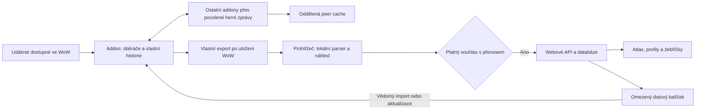
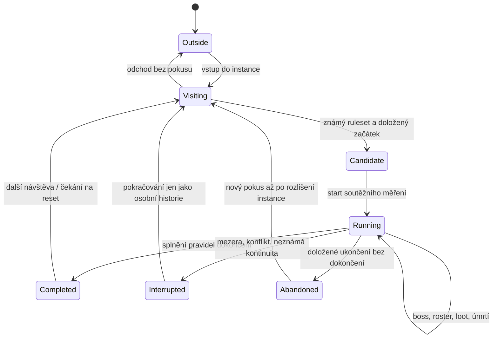

# Technický návrh

Verze 1.0 • 9. listopadu 2026 • návrh k implementaci, nikoli popis hotového systému

## 1. Architektura



Peer cache nemá exportní cestu na web. Neodesílá se ani jako příloha diagnostiky nebo úplná záloha addonové databáze.

### Doporučené části

| Část | Návrh |
| --- | --- |
| Addon | Lua kompatibilní s cílovým klientem; eventová architektura a adaptéry podle schopností API |
| Prohlížeč | TypeScript, React; parser v Web Workeru, IndexedDB pro lokální frontu a oprávněné file handles |
| Server | Jeden modulární backend v TypeScriptu, REST API a samostatně spustitelný worker ze stejného projektu |
| Databáze | PostgreSQL pro identity, granty, události, deduplikaci, projekce a frontu úloh |
| Velké soubory | Objektové úložiště pro schválené datové balíčky a případné pozdější očištěné logové části |
| Distribuce | Addon ZIP, manifest verze, datové balíčky a veřejná webová aplikace |

Konkrétní framework backendu a verze knihoven se při zahájení implementace připnou podle aktuální podpory. Preferujeme jeden udržovatelný backend před rozdělením na více služeb. Redis ani Kubernetes nejsou počáteční závislostí.

### Navržená struktura repozitáře

```text
addon/Evertally/
  Core/             lifecycle, kompatibilita, úložiště, zásady sdílení
  Collectors/       character, quests, loot, world, professions, instances
  Runs/             state machine a rulesety
  Sync/             povolená ingame komunikace
  UI/               historie, atlas, žebříčky, nastavení
  Locales/          csCZ, enUS a další
apps/web/           veřejné stránky, přihlášení, lokální import
apps/api/           ověřování uploadů, dotazy a správa účtů
apps/worker/        projekce, agregace, deduplikace, mazání
packages/contracts/ schémata událostí a datových balíčků
rulesets/           verzovaná pravidla dungeonů a raidových setkání
fixtures/           syntetická a výslovně poskytnutá očištěná testovací data
docs/               metodika, provoz a kompatibilita
```

Jde o budoucí strukturu. Tyto implementační adresáře zatím nebyly vytvořeny.

## 2. Vrstva kompatibility s WoW

Každé podporované rozhraní se ověřuje za běhu a testuje na konkrétním klientu. Číslo interface se zjistí z klienta; nainstalované addony na tomto počítači uvádějí pro Forever mimo jiné 16001, což není důkaz aktuálního běžícího buildu.

Vrstva `Capabilities` poskytne pro každý sběrač stav:

- `available`: požadovaná data jsou čitelná v daném kontextu.
- `deferred`: načtení se odloží například na konec boje nebo otevření profesního okna.
- `restricted`: hodnoty existují pro zobrazení, ale addon je nemůže bezpečně zpracovat.
- `unsupported`: klient funkci neposkytuje.
- `unknown`: ještě nebylo provedeno potřebné pozorování.

`pcall` chrání před chybou, ale nezmění chráněnou hodnotu na veřejná data. Zpracování musí před porovnáním, uložením nebo serializací vyloučit secret hodnoty podle dostupných bezpečných kontrol klienta. Názvy, GUID i čísla mohou být v konkrétním kontextu nepoužitelné.

Nepoužívat scraping chráněných obrazovek, čtení paměti hry, automatické vstupy ani obcházení omezených souřadnic.

### Kandidáti sběrných rozhraní

| Oblast | Kandidátní události/API | Podmínka |
| --- | --- | --- |
| Postava | `PLAYER_LOGIN`, `PLAYER_LEVEL_UP`, změny vybavení, `UnitClass`, `UnitRace`, `GetBuildInfo` | Kontrola čitelnosti a dostupnosti jednotlivých polí |
| Questy | `QUEST_ACCEPTED`, `QUEST_TURNED_IN`, `QUEST_LOG_UPDATE`, quest/gossip interakce | Ověřit payloady a okamžik dostupnosti odměn |
| Loot | `LOOT_OPENED`, změny slotů, `LOOT_CLOSED`, `GetLootSourceInfo`, vlastní loot události | Vztah zdroj–slot, area loot a prázdné lootování vyžadují samostatnou validaci |
| Lokace | `C_Map.GetBestMapForUnit`, `C_Map.GetPlayerMapPosition`, zónové události | Mapa/patro, souřadnicový systém, přesnost a restrikce |
| Profese | `TRADE_SKILL_SHOW`, `TRADE_SKILL_LIST_UPDATE`, `C_TradeSkillUI.GetAllRecipeIDs`, `GetRecipeInfo`, `GetRecipeSchematic` | Načíst po otevření; rozlišit vlastní a linknutou profesi |
| Instance | `PLAYER_ENTERING_WORLD`, zónové a roster události, `GetInstanceInfo` | Nevydávat každý load screen za nový pokus |
| Bossové | `ENCOUNTER_START`, `ENCOUNTER_END`, `BOSS_KILL` podle podpory | Deduplikace dvou událostí téhož killu; ověřit každou instanci |
| Bojové souhrny | `C_DamageMeter`, pokud je čitelný po boji | Chybějící segment není nulový výkon; oddělený volitelný modul |
| Ingame sync | `C_ChatInfo` a případně `C_BattleNet` datové zprávy | Limity, příjemci a blokace v boji se ověří v klientu |

Tato tabulka je implementační hypotéza podložená existujícím zdrojovým kódem, nikoli osvědčení funkčnosti všech funkcí v každé situaci. Evidence a konkrétní místa jsou v [ZDROJE.md](ZDROJE.md).

## 3. Oddělení místních dat

### Logická úložiště

| Úložiště | Obsah | Smí být automatickým zdrojem webového uploadu? |
| --- | --- | --- |
| `ownObservations` | Vlastní pozorování s původem a pokrytím | Pouze schválená projekce s platným webovým grantem |
| `ownRuns` | Vlastní pokusy a osobní účasti | Pouze schválená projekce |
| `peerCache` | Přijaté souhrny a cizí výsledky | Ne |
| `referenceCache` | Distribuovaný/importovaný atlas a snapshoty webu | Ne; zabránit zpětnému započítávání |
| `preferences` | UI, nastavení a výběr kategorií | Ne, kromě minimálních explicitních policy polí |
| `diagnostics` | Počty chyb a schopnosti API | Jen samostatný náhled dobrovolného reportu |
| `exportOutbox` | Minimalizované vlastní záznamy způsobilé pro web | Ano, pokud stále platí souhlas |

Doporučené pojmenování SavedVariables:

- `EvertallyDB`: lokální nastavení a vlastní historie.
- `EvertallyPeersDB`: oddělené přijaté peer údaje.
- `EvertallyExportDB`: pouze připravený webový export a jeho policy metadata.

Soubory mohou být v první iteraci rozdělené do pomocných addonů, aby browser nemusel procházet vlastní historii ani peer cache. Konkrétní souborové rozdělení musí respektovat způsob, jakým WoW SavedVariables skutečně zapisuje.

Prohlížeč v běžném režimu čte jen exportní soubor. Nevyžaduje právo zápisu do WTF ani přístup k celému disku.

### Kapacita a mazání

- Nepřijatá datová fronta má limit, počet a nejstarší datum. Při překročení nejprve zastaví nízkoprioritní opakované vzorkování.
- Důležité výsledky se nesmí tiše zahazovat. Před promazáním nabídnout přehled a zálohu.
- Peer cache má TTL a LRU limit. Expirace cache nezmění vlastní historii.
- Po potvrzeném přijetí lze z exportní fronty odstranit payload, nikoli účetní informaci nutnou k zabránění duplicitám.
- Balíček z webu obsahuje receipt nebo cursor. Jeho aplikace je explicitní datový import, ne vzdálené spuštění kódu.
- Uživatel bez webu má možnost lokální zálohy a přehled o limitu historie.

## 4. Model herních pozorování

### Společná obálka

| Pole | Význam |
| --- | --- |
| `schemaVersion` | Verze kontraktu |
| `eventId` | Identita vlastního pozorování: instalace/epoch/sekvence; není identitou skupinového běhu |
| `producerId` | Náhodná identita instalace; není důkaz osoby a nesmí se vydávat za anonymitu |
| `origin` | `local_observation`, `peer`, `reference` nebo `manual` |
| `kind` | Typ události |
| `game` | Produkt, region, realm, build, interface a případná content epoch |
| `observedAt` | UTC čas pozorování, rozlišení a časová základna |
| `sessionId` | Lokální herní session |
| `subject` | Herní entita nebo vlastní postava v lokální vrstvě |
| `payload` | Typovaná data bez libovolných objektů |
| `coverage` | Pozorovaná/neznámá/nedostupná pole a důvod neúplnosti |
| `evidence` | Způsob získání: API událost, snapshot, log, manuální doplnění |
| `policy` | Rozsah povoleného užití a epoch souhlasu; na serveru se kontroluje proti grantu |

Žádná klientská obálka sama nedokazuje pravdivost svého obsahu. Zvláště `origin=local_observation` nesmí být zaměněn za kryptografický důkaz původu.

### Základní typy

```text
character.snapshot, character.level
quest.accepted, quest.objective, quest.turned_in, quest.abandoned
npc.observed, object.observed, vendor.snapshot, trainer.snapshot
loot.window, loot.received, gathering.result
profession.snapshot, recipe.learned, craft.result, cooldown.snapshot
instance.entered, run.started, run.roster, run.boss, run.finished, run.interrupted
raid.encounter_started, raid.encounter_finished
economy.purchase, economy.sale, auction.snapshot
```

Každý typ má svůj whitelist polí a maximální velikost. Neexistuje univerzální `extra` objekt umožňující přenést chat nebo libovolný obsah paměti.

### Význam chybějících hodnot

- `null`/chybějící pole: údaj není znám.
- `0`: nula byla skutečně změřena při úplném pokrytí dané metriky.
- `unavailableReason`: například `restricted`, `not_observed`, `late_join`, `source_ambiguous`, `api_missing`.
- Odvozené metriky uvádějí algoritmus a vstupní pokrytí.

### Lokace

Lokace je objekt `mapId`, volitelné `floorId`, `coordinateSpace`, `x`, `y`, `sourceMethod`, `precision`, `observedAt`. Smíšené souřadnicové systémy se nesčítají. Převod mapy nebo patra má explicitní verzi.

Veřejný atlas agreguje pozorování herních entit po prostorových buňkách. Nemá sloupec s veřejnou aktuální polohou konkrétního přispěvatele.

### Vztahy místo přepisování jediné pravdy

Například vztah `NPC → prodává → item` obsahuje zdroj, verzi hry, první a poslední výskyt, nezávislá pozorování a konflikty. Nový chybějící snapshot obchodníka nevymaže automaticky starší doložený prodej: zásoba může být vyprodaná nebo snapshot neúplný.

## 5. Stavový automat běhu



Implementace smí spojit `Candidate` a `Running` interně, ale nesmí ztratit důvod způsobilosti. „Přerušené měření“ není totéž jako opuštěný dungeon a nesmí zhoršovat completion rate hráče jako jistý abandon.

### Čas a kontinuita

- Uvnitř jedné session měřit délku monotónním časem.
- UTC slouží k řazení a synchronizaci; změna systémových hodin nesmí vyrobit záporné či rekordní trvání.
- Uložit checkpoint a časovou základnu. Po relogu/reloadu nepokračovat v přesném rankovaném čase jen odečtením dvou hrubých timestampů bez ověření.
- Pokud log nebo jiný ověřený zdroj dokládá kontinuitu, lze přes pravidla obnovit měření; jinak `interrupted`, osobní historie zůstane.
- Čas má uložené rozlišení. UI nezaokrouhluje odhad na falešné setiny sekundy.

### Reset a skupinové ID

- Addon si vytvoří vlastní session token; neslibuje globální serverové instance ID tam, kde ho API neposkytuje.
- Před bojem mohou spolupracující addony odsouhlasit společný náhodný token pokusu. Je to pomůcka pro korelaci, nikoli důkaz čerstvé instance.
- Pozdější připojení dostane původní token, ale vlastní záznam zůstane `late_join`.
- Nejasné rozlišení dvou instancí přejde do konfliktu. Neslučovat dva rychlé následné běhy jen podle stejných členů a času v jedné minutě.
- Neprovedený handshake není chyba osobní historie; snižuje možnosti automatického potvrzení skupinového běhu.

### Ruleset

Obsahuje ID instance/křídla, povinné bossy, způsob jejich identifikace, povolené start/end události, levelové hranice, velikost skupiny, pravidla výměn členů a verzi. Vydání rulesetu vyžaduje herní záznam splňující příslušné akceptační scénáře.

## 6. Ingame synchronizace

### Přenos

- Vlastní verzovaný prefix a samostatné zprávy `HELLO`, `SUMMARY`, `REQUEST`, `DATA`, `ACK`, `REVOKE`.
- Přímá skupina/raid, guilda a podporované přátelské datové kanály. Žádný neomezený globální broadcast.
- Začít přenosem malých souhrnů; detail vyžádat až při otevření pohledu nebo aktualizaci vybrané sady.
- Zprávy dělit podle skutečně ověřeného limitu daného transportu. Nepředpokládat jeden limit pro všechny verze WoW a Battle.net.
- Fronta je omezená, řízená token bucketem a pozastavená v boji či při odmítnutí transportu.
- Neúplný přenos má timeout; klient ho nesmí donekonečna zkoušet bez backoffu.
- Příjemce ověří protokol, odesílatele, délku, počet chunků, kompresní poměr a payload schema.
- Kontrolní součet odhalí poškození, ale není důkazem pravosti či souhlasu.

### Vlastnictví a cache

- Přijatý záznam vždy skončí v `peerCache`, i kdyby v payloadu tvrdil jiný `origin`.
- Odesílatel sdílí jen vlastní povolenou projekci, příjemce ji nemůže automaticky přeposlat ani zařadit do exportu.
- Cache nese zdroj, scope, verzi a expiraci.
- Odvolání přes `REVOKE` odstraní záznam u dosažitelných příjemců. Offline kopie může zůstat do další synchronizace či TTL; UI to nezakrývá.
- Běh může být v peer přehledu z více nezávislých účastí. Statistiky skupinových běhů je nesmí sčítat jako nezávislé cleary.

### Hranice důvěry

Ingame zprávy jsou nedůvěryhodný vstup. Upravený addon může poslat falešné číslo i zkopírovat přijatá data jinam. Naše klienty a server musí respektovat policy, ale distribuované Lua prostředí neposkytuje neobejitelný zákaz kopírování. Produkt nesmí slibovat takovou ochranu.

## 7. Dobrovolný webový přenos

### Výchozí cesta bez dalšího programu

1. Hráč navštíví web. Veřejné prohlížení nevyžaduje přístup k souborům.
2. Přihlásí se a otevře „Moje data → Propojit“.
3. Zvolí postavy, datové oblasti a zda bude profil soukromý nebo veřejný.
4. Web vytvoří serverový upload grant. Při nastavení addonu se povolí příprava příslušného exportu.
5. Hráč vybere konkrétní exportní soubor; folder polling je rozšířená volba. Prohlížeč žádá jen čtení.
6. Po zápisu WoW parser v prohlížeči přečte export a ukáže počty a ukázku povolených polí.
7. První odeslání vyžaduje tlačítko „Odeslat vybraná data“. Průběžné odesílání nových vlastních záznamů je další volba.
8. Server provede validaci, deduplikaci a vrátí receipt s přijatými/odmítnutými eventy.
9. UI ukazuje čas posledního úspěšného přenosu a reálný stav čekající fronty.

Povolení složky neznamená zveřejnění profilu. Technické oprávnění prohlížeče ani samotné přihlášení nesmí automaticky zapnout upload.

### Prohlížeče a omezení

`showDirectoryPicker` vyžaduje podporovaný prohlížeč, bezpečný kontext a uživatelskou akci; dostupnost není univerzální. Kontrolovat funkce za běhu a nabídnout běžný výběr souboru. [MDN: showDirectoryPicker](https://developer.mozilla.org/en-US/docs/Web/API/Window/showDirectoryPicker)

Handle lze podle podpory uložit lokálně, ale oprávnění se musí znovu kontrolovat. Otevřená stránka může být uspána, zavřena či přijít o oprávnění; web neslibuje nepřetržitou synchronizaci na pozadí. [Chrome: File System Access](https://developer.chrome.com/docs/capabilities/web-apis/file-system-access)

Pro Firefox, Safari, odmítnuté oprávnění nebo citlivou složku je rovnocennou cestou výběr připraveného exportního souboru či vložení datového kódu. Nesmí se žádat změna zabezpečení prohlížeče.

### Co se dostane ven kdy

| Zdroj | Přenos |
| --- | --- |
| SavedVariables | Až WoW provede zápis, typicky po reloadu/odhlášení; změny v paměti nejsou souborem na disku |
| Připravený zkopírovaný export | Po vědomém vložení na web, s aktuálně platným souhlasem |
| Combat log | Pozdější samostatný import; může mít zpoždění zápisu podle klienta, nelze slíbit živý přenos během boje |
| Peer cache | Automatickým webovým importem nikdy |

První verze nesmí k rychlému uploadu vyvolávat opakovaný automatický `/reload`. Hráč musí mít možnost odehrát celý večer a odeslat až poté.

### Bezpečný parser

- Uložený Lua soubor je nedůvěryhodný vstup. Nespouštět ho pomocí `eval`, `loadstring`, vloženého Lua interpretu ani serverového shellu.
- Parser akceptuje pouze omezenou datovou gramatiku: známou kořenovou proměnnou, tabulky, dovolené klíče, řetězce, konečná čísla, boolean a nil.
- Odmítá volání funkcí, výrazy, metatabulky, odkazy na jiné globální proměnné a neznámé spustitelné konstrukce.
- Podporuje skutečné escapování WoW serializeru, UTF-8, komentáře a případné BOM podle fixture dat. Nejde o naivní převod Lua na JSON regulárním výrazem.
- Výsledné objekty nemají prototyp, nebezpečné klíče jsou odmítnuté a před uploadem proběhne druhá schema validace.
- Limity velikosti, hloubky, počtu polí a doby zpracování. Parser běží mimo hlavní UI vlákno.
- Když soubor není celý zapsaný, ponechat poslední platný snapshot a opakovat čtení po stabilizaci. Nikdy neposlat polovinu databáze jako nový úplný stav.
- Neupravovat soubor SavedVariables během běhu hry.

## 8. Souhlasy a odvolání

### Souhlas je verzovaný serverový grant

Grant obsahuje vlastníka webového účtu, identitu zdroje, scopes, seznam postav, počáteční čas dat, `consentEpoch`, verzi podmínek, datum aktivace a odvolání. Anonymní/pseudonymní upload nemá oprávnění publikovat jmenný profil.

Scope má konkrétní význam, například `world_facts`, `own_runs`, `own_character`, `own_professions`. Veřejná viditelnost profilu je další serverové oprávnění. Klientský checkbox sám nevytvoří serverový souhlas.

Import nesmí přijmout cizí peer záznam jen proto, že odesílatel ve webovém formuláři zaklikl souhlas. Souhlas se vztahuje k vlastním projekcím přispěvatele.

### Vypnutí

- Webové „Zastavit přenos“ ihned revokuje grant na serveru a přeruší frontu prohlížeče.
- Ingame „Web vypnut“ ihned zastaví přípravu nových exportních dat v paměti addonu a zneplatní dosavadní exportní frontu pro další zápis.
- Běžící prohlížeč nemůže znát změnu provedenou pouze v paměti hry, dokud ji hra neuloží. Starší soubor na disku může do té doby vypadat povoleně.
- UI proto uvede: „Pro okamžité zastavení také vypni přenos na webu; pro propsání nastavení do souboru použij /reload nebo se odhlas.“ Nesmí tvrdit okamžité globální odvolání z ingame checkboxu.
- Nejvyšší zpracovaná epoch se pamatuje; server odmítá granty starší nebo odvolané. Obnovení starého souboru neobnoví serverový souhlas.
- Znovuzapnutí vytvoří nový grant. Zahrnutí starších dat je nová explicitní volba.

### Mazání a viditelnost

- Skrytí profilu odstraní veřejné odkazy a položky žebříčků bez zbytečného odkladu.
- Smazání vlastních importů má sledovatelný stav a recompute odvozených statistik. Cache a distribuované datové balíčky mají expiraci a tombstone při další aktualizaci.
- Již stažené offline kopie nelze vzdáleně okamžitě smazat. Spravované klienty odvolání aplikují při nejbližším získání nové verze.
- Zálohy respektují popsanou retenční lhůtu a mazání se po obnově znovu aplikuje.
- V produkční metodice vysvětlit, která skutečně anonymizovaná agregace může přetrvat a jak se liší od pouhého zahashování identity.

## 9. Návrat webových dat do hry

Samotný addon nebude provádět HTTP dotazy. První verze nabídne dvě cesty:

1. Běžná aktualizace distribuovaného datového addonu/balíčku. Obsah se načte při přihlášení či reloadu podle typu změny.
2. Omezený kód ke zkopírování z webu do addonu: například konkrétní dungeon, vybrané profily nebo časově omezený žebříček.

Import je pouze serializovaná data s verzí, velikostí, časem platnosti a kontrolním součtem. Nepoužívá `loadstring`. Velké balíčky se nelepí do jednoho herního editboxu; zvolí se omezená podmnožina nebo datový addon.

Původ „importovaný webový snapshot“ je vždy viditelný. Bez podpory podpisu či důvěryhodného distribučního kanálu se import nepovažuje za autentizovaný pouze kvůli správnému hashi.

Samostatná aplikace může později zjednodušit čtení uložených souborů a aktualizace dat. Je volitelná, nerozšiřuje práva Lua addonu a nesmí editovat právě používané SavedVariables.

## 10. Backend a projekce

### Datové tabulky

| Tabulka/skupina | Účel |
| --- | --- |
| `users`, `sessions` | Webové účty a přihlášení |
| `sources`, `consent_grants` | Zdroj uploadu a platná oprávnění |
| `characters`, `character_claims`, `profile_visibility` | Identity postav, stav tvrzení o vlastnictví a publikace |
| `uploads`, `upload_items`, `observations` | Příjem, validace a omezeně uchované podklady |
| `entities`, `entity_versions`, `relations` | Atlas herních entit a verzované vztahy |
| `runs`, `run_reports`, `participations`, `boss_results` | Skupinový běh, zprávy pozorovatelů a účasti odděleně |
| `loot_opportunities`, `loot_observations` | Jmenovatele a nálezy s kvalitou pokrytí |
| `recipe_snapshots`, `craft_results`, `cooldowns` | Profesní data |
| `ranking_rulesets`, `ranking_entries`, `ranking_snapshots` | Verze pravidel a přepočitatelné žebříčky |
| `jobs`, `deletions`, `moderation_cases`, `audit_events` | Fronta úloh, mazání a správa |

Události jsou immutable podklady s dobou uchování. Projekce lze znovu postavit podle aktuálního algoritmu; oprava pravidel nesmí přepsat původně pozorovaný čas.

### Příjem uploadu

1. Ověřit session, grant, scope, epoch, limity a vlastnictví importního zdroje.
2. Vstupní schema s whitelistem polí; odmítnout nepovolené identity ještě před uložením payloadu.
3. Ověřit konečná čísla, časové pořadí, jednotky a deklarovanou verzi hry.
4. Idempotentně uložit vlastní eventy podle identity zdroje a event ID.
5. Pro každou položku vrátit výsledek; částečný úspěch nesmí vést k tiše ztraceným datům.
6. Odděleně spustit normalizaci, deduplikaci skupinových běhů, atlas a žebříčky.

Batch limit pro návrh: nejvýše 500 událostí a 1 MiB nekomprimovaného JSON. Limity se při měření upraví; nejsou tvrzením o výkonu. Raw logy nejsou povoleným payloadem této cesty.

### REST kontrakt

| Metoda a cesta | Funkce |
| --- | --- |
| `GET /v1/capabilities` | Podporované schema, limity a datové oblasti |
| `POST /v1/consents` | Vytvoření nového scoped grantu po vědomé volbě |
| `DELETE /v1/consents/{id}` | Okamžité odvolání grantu |
| `POST /v1/uploads` | Přijetí omezené sady vlastních událostí |
| `GET /v1/uploads/{id}` | Stav přijetí, receipt a důvody odmítnutí |
| `GET /v1/me/data` | Přehled vlastních importů a viditelnosti |
| `POST /v1/me/deletions` | Žádost o mazání vybraných kategorií/období |
| `PATCH /v1/me/profiles/{id}` | Nastavení veřejnosti a zvolených polí |
| `GET /v1/entities/{type}/{id}` | Atlas s verzí, původem a pokrytím |
| `GET /v1/runs/{id}` | Veřejná projekce běhu podle přístupových práv |
| `GET /v1/leaderboards` | Kurzorovaný žebříček s povinným rulesetem a filtry |
| `GET /v1/exports/{kind}` | Omezený datový snapshot pro addon |

Chyby mají stabilní kódy, například `consent_revoked`, `schema_unsupported`, `scope_denied`, `peer_record_rejected`, `source_conflict`, `rate_limited`. Klient neodhadne úspěch z HTTP 200 bez kontroly jednotlivých položek.

Všechny změny jsou autorizované na serveru. Cookie session má odpovídající CSRF ochranu; žádné tokeny ve veřejné addonové databázi, URL nebo chybových výpisech. Pozdější uploader dostane samostatný omezený revokovatelný token.

## 11. Deduplikace a důvěryhodnost

### Různé druhy duplicity

- Stejný soubor znovu: transportní idempotence.
- Stejná událost poslaná po pádu stránky: stejný `eventId`, nový příjem nic nepřičítá.
- Více záznamníků stejného dungeonového běhu: více `run_reports`, jeden canonical run po korelaci.
- Stejný drop viděný více členy: jedna lootová příležitost s více důkazy, pokud lze zdroj spojit.
- Stejné herní pravidlo pozorované v různých skutečných bězích: další nezávislé pozorování.

Korelace využije shared run token, instance context, časové intervaly a posloupnost bossů. Identitami lidí bez webového souhlasu se nenahrazuje chybějící korelace. Při nejistotě se případ zařadí do konfliktů a v globálním počtu se nepovažuje za několik jistých samostatných clearů.

### Úrovně doložení

| Stav | Význam |
| --- | --- |
| Ruční | Hráč zadal nebo upravil údaj |
| Automaticky pozorované | Jedna podporovaná instalace zaznamenala požadované události |
| Křížově potvrzené | Více věcně souhlasících záznamů se samostatnou proveniencí |
| Kontrolované | Kontrola pravidel, plausibility a případně moderátora |
| Konfliktní | Nesoulad nebo nemožnost rozhodnout |

Žádná úroveň se neoznačuje za serverem nezfalšovatelný výsledek bez skutečného důvěryhodného serverového zdroje. Hash a podpis distribučního balíčku mohou ověřit přenos balíčku, nikoli pravdivost hry zaznamenané uživatelem.

Účet na webu sám nepotvrdí herní vlastnictví postavy. Pokud bude oficiální ověřovací API pro Forever dostupné, přidá se samostatně. Do té doby profil nese pravdivé označení, například „postava uvedená přispěvatelem“.

## 12. Statistiky světa a změny patche

- Rozlišit build klienta a serverový hotfix. Pokud datum hotfixu není známé, zaznamenat čas a označit content epoch jako nejistou.
- Změněná data nevymažou historické vztahy. Zobrazí se poslední známý stav a možnost starší verze.
- U četností uvést definici výběru a velikost vzorku. Výsledky zapojených hráčů mají výběrové zkreslení.
- Kompletní lootové příležitosti a pozitivní nálezy mají oddělené projekce. Dokud není důvěryhodný jmenovatel, procenta se nepublikují.
- Mapové piny nepoužívají počet relay kopií jako počet nezávislých zdrojů.
- Data importovaná z Classicu nebo externí databáze se označí odlišně a nedokládají ověření ve Foreveru.

## 13. Provoz a aktualizace

- Verzování zvlášť pro addon, schema, ingame protokol, datové balíčky a rulesety.
- Migrace lokální databáze vytvoří obnovitelnou zálohu a nesmaže neznámé budoucí schema.
- Neznámý payload verze se bezpečně odmítne; UI nabídne aktualizaci.
- Změna pravidel vyvolá přepočet projekce se zachováním vysvětlení.
- Server loguje technické identifikátory a agregované počty. Payloady, cestu obsahující název účtu ani citlivé tokeny neloguje.
- Sledovat frontu, doby projekcí, odmítnutí uploadů, duplicity, mezery měření a chyby souhlasů.
- Veřejná data mohou mít cache. Soukromé profily a session nikoli veřejně sdílenou cache.
- Zálohy a obnovení PostgreSQL musí být ověřené obnovou na odděleném prostředí.
- Produkční provoz vyžaduje zvolený hosting, provozovatele a doménu. Zadání žádné služby nekupuje ani nenasazuje.
